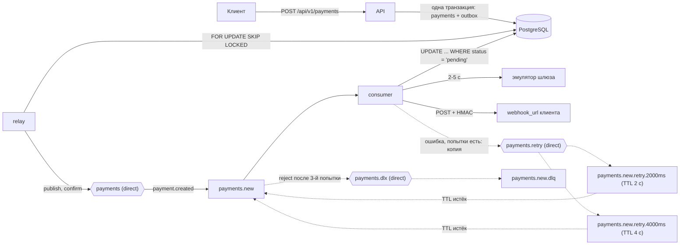

# Асинхронный процессинг платежей

Сервис принимает запрос на оплату и сразу отвечает `202 Accepted`. Сам платёж обрабатывается в фоне: эмулятор внешнего шлюза думает 2-5 секунд и одобряет 90% платежей, после чего клиенту уходит вебхук с результатом.

Что гарантируется:

- событие о новом платеже не теряется, даже если RabbitMQ в этот момент лежит (outbox), а платёж, застрявший в `pending`, через 5 минут снова отправляется в обработку;
- повтор запроса не создаёт второй платёж (Idempotency-Key);
- сбой доставки вебхука повторяется с растущей паузой, а безнадёжное сообщение уходит в DLQ, откуда его можно вернуть одной командой;
- если сервер клиента лежит, circuit breaker перестаёт слать ему запросы и откладывает вебхуки, не тратя их попытки.

Стек: Python 3.13, FastAPI, Pydantic v2, SQLAlchemy 2 (async, asyncpg), PostgreSQL 17, Alembic, RabbitMQ 4.4, FastStream 0.7, httpx, Poetry, Ruff, pytest, Docker Compose.

## Быстрый старт

```bash
docker compose up --build
```

| Сервис | Адрес с хоста | Что это |
|---|---|---|
| `api` | http://127.0.0.1:8090/docs | FastAPI, Swagger (кнопка Authorize для ключа) |
| `rabbitmq` | http://127.0.0.1:15682 (`payments` / `payments`) | RabbitMQ management UI: очереди, обменники, DLQ |
| `webhook-receiver` | http://127.0.0.1:8091/received | приёмник вебхуков, играет роль сервера клиента |
| `postgres` | `127.0.0.1:5442` (`payments` / `payments`) | база |
| `relay` | | публикует события из outbox в RabbitMQ |
| `consumer` | | обрабатывает платежи и шлёт вебхуки |

API-ключ для локального запуска: `local-dev-api-key` (переменная `API_KEY`). Это учебное значение из `docker-compose.yml`, секрет подписи вебхуков задан там же. Порты и параметры меняются в `.env` (см. `.env.example`).

Прогнать сценарии против поднятого стека (10 платежей, идемпотентность, ретраи, DLQ и возврат из неё, circuit breaker), около минуты:

```bash
docker compose exec api python -m scripts.demo
```

Тесты (юнит и интеграционные на настоящих PostgreSQL и RabbitMQ) и линтер:

```bash
docker compose --profile test run --rm tests
docker compose --profile test run --rm tests ruff check .
```

## Примеры

Создать платёж:

```bash
curl -s -i -X POST http://127.0.0.1:8090/api/v1/payments \
  -H 'X-API-Key: local-dev-api-key' -H 'Idempotency-Key: order-1001' \
  -H 'Content-Type: application/json' \
  -d '{"amount": "1500.00", "currency": "RUB", "description": "Погашение займа",
       "metadata": {"loan_id": "L-1001"}, "webhook_url": "http://webhook-receiver:9000/webhook"}'
```

```text
HTTP/1.1 202 Accepted
location: /api/v1/payments/2b8e2282-577f-492f-bab5-204fb50e5ffc

{"payment_id": "2b8e2282-577f-492f-bab5-204fb50e5ffc", "status": "pending", "created_at": "2026-11-17T15:22:49.964264Z"}
```

Тот же запрос ещё раз вернёт тот же платёж (тоже `202`, плюс заголовок `Idempotent-Replayed: true`). Тот же ключ с другим телом:

```json
422 {"detail": {"code": "idempotency_key_reused", "message": "this Idempotency-Key was used with a different request body"}}
```

Без ключа идемпотентности ответ `400 idempotency_key_required`, без `X-API-Key` или с неверным ключом `401 unauthorized`.

Через несколько секунд:

```bash
curl -s http://127.0.0.1:8090/api/v1/payments/2b8e2282-577f-492f-bab5-204fb50e5ffc -H 'X-API-Key: local-dev-api-key'
```

```json
{
  "payment_id": "2b8e2282-577f-492f-bab5-204fb50e5ffc",
  "status": "succeeded",
  "amount": "1500.00",
  "currency": "RUB",
  "description": "Погашение займа",
  "metadata": {"loan_id": "L-1001"},
  "failure_reason": null,
  "idempotency_key": "order-1001",
  "webhook_url": "http://webhook-receiver:9000/webhook",
  "created_at": "2026-11-17T15:22:49.964264Z",
  "processed_at": "2026-11-17T15:22:55.333270Z",
  "webhook_delivered_at": "2026-11-17T15:22:55.345935Z"
}
```

Что дошло до «клиента»: `curl -s http://127.0.0.1:8091/received`.

Посмотреть ретраи и DLQ вживую:

```bash
curl -s -X PUT http://127.0.0.1:8091/mode -H 'Content-Type: application/json' -d '{"fail": true}'
# создать платёж как выше (с новым Idempotency-Key) и смотреть: логи consumer, очереди в UI RabbitMQ
docker compose logs -f consumer
# через ~10 секунд сообщение в payments.new.dlq; починить «клиента» и вернуть сообщение
curl -s -X PUT http://127.0.0.1:8091/mode -H 'Content-Type: application/json' -d '{"fail": false}'
docker compose exec consumer python -m app.messaging.dlq --replay
```

## Как устроено



```text
app/
  core/            настройки, БД, JSON-логи
  domain/          валюты, статусы, событие PaymentCreated, тело вебхука (без I/O)
  db/              ORM-модели payments и outbox, репозитории, UnitOfWork
  services/        сценарии: создание платежа (идемпотентность + outbox), обработка платежа; порты
  integrations/    эмулятор шлюза, отправка вебхуков (httpx, HMAC), circuit breaker
  messaging/       топология RabbitMQ, relay, consumer, политика повторов, команда для DLQ
  api/             роуты, схемы, X-API-Key
  bootstrap.py     сборка зависимостей для api, relay и consumer
  main.py          FastAPI-приложение
webhook_receiver/  приёмник вебхуков для демо
migrations/        Alembic
tests/             unit/ и integration/
scripts/demo.py    прогон сценариев против живого стека
```

Три процесса из одного образа: `api` (`uvicorn app.main:create_app --factory`), `relay` (`python -m app.messaging.relay`) и `consumer` (`faststream run app.messaging.consumer:create_app --factory`). API вообще не ходит в RabbitMQ.

## Решения

### Outbox

Если API сохраняет платёж и сразу публикует событие, между этими шагами может случиться что угодно: процесс упал после коммита, брокер недоступен. Тогда платёж в базе есть, а события нет, и платёж навсегда остаётся `pending`. Поэтому:

1. API в **одной транзакции** пишет строку в `payments` и строку в `outbox` (`payment.created`). Либо обе есть, либо нет ни одной (есть тест: запись в outbox падает на ограничении БД, и платёж тоже не сохраняется).
2. Отдельный процесс `relay` раз в 0,5 секунды берёт пачку неопубликованных строк: `SELECT ... FOR UPDATE SKIP LOCKED`. `SKIP LOCKED` значит, что строки, которые держит другой экземпляр relay, пропускаются, а не ждут. Поэтому relay можно запускать в нескольких копиях, одно событие одновременно не опубликуют дважды (тоже есть тест).
3. Каждое событие публикуется с **publisher confirms**: `publish()` возвращается, только когда брокер подтвердил, что взял сообщение (для persistent-сообщения в durable-очереди это значит «записал на диск»). Ещё два флага: `persist=True` (сообщение переживает рестарт брокера, по умолчанию в FastStream выключено) и `mandatory=True` вместе с `on_return_raises=True` (если для routing key нет ни одной очереди, брокер вернёт сообщение и `publish()` упадёт, а не потеряет его молча).
4. Только после подтверждения строка помечается `published_at` и транзакция коммитится. Если публикация не удалась, у строки растёт `attempts`, пишется `last_error`, а следующая попытка откладывается: 1, 2, 4, ... 60 секунд. Одна неудачная строка не задерживает строки за ней. Три неудачи подряд значат, что недоступен сам брокер, и пачка обрывается до следующего опроса.

Доставка **at-least-once**: если relay упадёт после публикации, но до коммита, событие уйдёт ещё раз. Поэтому consumer обязан быть идемпотентным. `message_id` у сообщения равен `event_id` из outbox, по нему повтор видно в логах.

Проверено вживую: при остановленном RabbitMQ API отвечает `202`, relay копит неудачные попытки с растущей паузой, после `docker compose start rabbitmq` событие уходит (соединение aio-pika переподключается само), и платёж обрабатывается.

### Страховка от зависших платежей

Outbox гарантирует, что событие дойдёт до RabbitMQ. Но дальше сообщение ещё может оказаться там, откуда его никто не заберёт. Например, PostgreSQL перезапускался 10 секунд: consumer за это время израсходует три попытки, сообщение уйдёт в DLQ, а платёж останется `pending`. Поэтому relay раз в 30 секунд ищет платежи, которые висят в `pending` дольше 5 минут после **публикации** своего последнего события, и кладёт для них новое событие в outbox.

- Время считается от публикации, а не от создания события. Если брокер лежал час, событие только что ушло в очередь, и дубль ему не нужен.
- Страховка не отличает потерянное сообщение от сообщения, которое просто долго стоит в очереди (например, consumer лежит). Поэтому паузы растут, 5, 10 и 20 минут, а новых событий на платёж не больше трёх. Платёж, застрявший навсегда, не будет бесконечно кормить DLQ: после трёх попыток он остаётся людям (и логам).
- Если событие ещё ждёт публикации, новое не добавляется. Это гарантирует сама база: частичный уникальный индекс разрешает одному платежу одно неопубликованное событие, а вставка идёт через `ON CONFLICT DO NOTHING`. Поэтому два relay, запущенные одновременно, не положат дубль (есть тест).
- Лишнее событие безопасно, но не бесплатно. Если дубль и оригинал обрабатываются одновременно, оба увидят `pending` и оба спросят шлюз. Записан будет один результат, а двойного списания нет, потому что шлюз получает `payment_id` как ключ идемпотентности. С настоящим шлюзом это обязательное условие.
- Платёж, у которого не дошёл только вебхук, сам не повторяется. Его сообщение ждёт в DLQ, пока человек не вернёт его командой replay (см. ниже).

### Idempotency-Key

- Заголовок обязателен (без него или с пустым значением `400`), длина до 255 символов. На `idempotency_key` в таблице уникальный индекс.
- Вставка через `INSERT ... ON CONFLICT (idempotency_key) DO NOTHING`. Если два запроса с одним ключом пришли одновременно, второй ждёт на уникальном индексе, пока первая транзакция закончится, ничего не вставляет и читает существующий платёж. Ни второго платежа, ни второй записи в outbox (тест: 10 одновременных запросов дают один платёж и одно событие).
- Чтобы отличить повтор от ошибки клиента, хранится `request_hash`: SHA-256 нормализованного тела. `1500` и `"1500.00"` дают один хеш, порядок ключей в `metadata` не важен.
- Тот же ключ и то же тело: `202`, тот же `payment_id`, **текущий** статус и заголовок `Idempotent-Replayed: true`. Тот же ключ с другим телом: `422 idempotency_key_reused`. Я выбрал 422, а не 409, как в черновике IETF про заголовок Idempotency-Key: 409 там для ситуации «первый запрос с этим ключом ещё выполняется». Здесь такого состояния нет, создание это одна короткая транзакция.
- Ключ уникален глобально: клиент один, ключ API тоже один. Когда клиентов станет несколько, уникальным должна быть пара `(client_id, idempotency_key)`.

### Consumer и повторная доставка

В сообщении только `payment_id`, состояние consumer читает из БД: база это единственный источник правды, а сообщение может прийти дважды или поздно. Порядок действий:

1. Если платёж `pending`, consumer идёт в шлюз (2-5 секунд, транзакция и соединение с БД в это время не держатся).
2. Переводит статус условным `UPDATE payments SET status = ... WHERE id = ... AND status = 'pending'`. Если два consumer обработали одно сообщение одновременно, второй `UPDATE` не изменит ни одной строки, и оба продолжат с тем статусом, который записался первым (тест на это есть, в том числе когда шлюз ответил им по-разному).
3. Отправляет вебхук, если `webhook_delivered_at` ещё пустой, и ставит его.

Повторная доставка уже обработанного платежа не идёт в шлюз, а только досылает вебхук, если он не дошёл. Эмулятор шлюза вычисляет исход из `payment_id` (это seed генератора случайных чисел): повторный вызов для того же платежа даёт тот же ответ. Так ведёт себя настоящий шлюз, если передать ему ключ идемпотентности.

Consumer берёт из очереди до 10 сообщений сразу (`prefetch`, настройка `CONSUMER_PREFETCH`). aiormq запускает отдельную задачу на каждое сообщение, так что 10 платежей по 2-5 секунд обрабатываются параллельно.

### Что считать ошибкой

«10% ошибка» в задании можно понять двумя способами. Я разделил их так:

- **Отказ шлюза** (10% платежей: `insufficient_funds`, `do_not_honor`, `card_expired`) это нормальный бизнес-результат. Платёж становится `failed` с `failure_reason`, клиенту уходит вебхук `payment.failed`. Повторять нечего: тот же шлюз ответит так же.
- **Сбой инфраструктуры** (вебхук не принят: сеть, таймаут, любой не-2xx; недоступна БД; шлюз не ответил, `GatewayUnavailableError`) это повод попробовать ещё раз. Такие ошибки идут в retry и затем в DLQ. Эмулятор шлюза в стеке недоступность не изображает, этот путь проверен тестами.

«3 попытки» я понимаю как три попытки всего: первая и два повтора, после третьей неудачи сообщение уходит в DLQ. Меняется настройками `MAX_ATTEMPTS` и `RETRY_BASE_DELAY_SECONDS`.

### Повторы и DLQ в RabbitMQ

Коротко о терминах. Публикуют не в очередь, а в **exchange** (обменник) с **routing key**. Exchange типа `direct` кладёт сообщение в очереди, привязанные (**binding**) с тем же ключом. Consumer подтверждает сообщение (**ack**), и брокер его удаляет. Или отказывается от него (**reject/nack**), и тогда брокер либо возвращает его в очередь (`requeue=True`), либо отправляет в **dead letter exchange**, если он задан у очереди (`x-dead-letter-exchange`). **TTL** (`x-message-ttl`) это время жизни сообщения в очереди. Когда оно истекает, сообщение тоже уходит в dead letter exchange.

| Обменник | Очередь | Аргументы очереди | Зачем |
|---|---|---|---|
| `payments` | `payments.new` (ключ `payment.created`) | DLX `payments.dlx` | основная очередь, её читает consumer |
| `payments.retry` | `payments.new.retry.2000ms`, `payments.new.retry.4000ms`, `payments.new.retry.30000ms` | TTL, DLX `""` с ключом `payments.new` | очереди задержки, их никто не читает (последняя для circuit breaker) |
| `payments.dlx` | `payments.new.dlq` (ключ `payments.new`) | | сообщения, которые обработать не удалось |

Как это работает:

- Попытка 1 или 2 не удалась: consumer публикует копию сообщения в `payments.retry` с ключом нужной очереди задержки и заголовком `x-attempt` на единицу больше. Только после подтверждения брокера он делает `ack` оригинала. Если упасть между этими шагами, получится дубль (его поглотит идемпотентность), но не потеря.
- Копия лежит в очереди задержки, пока не истечёт TTL. Потом брокер отправляет её через exchange по умолчанию (`""`, он кладёт сообщение в очередь с именем, равным ключу) прямо в `payments.new`. Именно туда, а не в `payments`: иначе копию получили бы и другие очереди, подписанные на `payment.created`.
- Третья попытка не удалась: consumer делает `reject(requeue=False)`, и RabbitMQ сам переносит сообщение в `payments.new.dlq`, добавив заголовок `x-death` (откуда и почему). В заголовке `x-last-error` видна ошибка предыдущей попытки, последняя есть в логе `attempts_exhausted_to_dlq`.
- Сообщение, которое никогда не обработается (битый JSON, несуществующий платёж), уходит в DLQ сразу, без повторов.
- Если копию для повтора опубликовать не удалось (брокер не подтвердил её за 10 секунд или очередь задержки удалили), оригинал тоже уходит в DLQ. Иначе он крутился бы в `payments.new` без паузы, и каждый круг заново слал бы вебхук.

Почему так, а не иначе:

- **Отдельная очередь на каждую задержку.** Сообщения с истёкшим TTL RabbitMQ убирает только из головы очереди. Если в одной очереди лежат сообщения с разным TTL, длинное блокирует короткие за собой. У каждой очереди задержки один TTL, и голова всегда истекает первой. Задержка входит в имя очереди: если поменять настройку, появится новая очередь, а не ошибка повторного объявления с другим `x-message-ttl`.
- **Свой счётчик `x-attempt`, а не `x-death`.** Копия публикуется заново, а это для брокера новое сообщение. `x-death` при этом не переносится (с RabbitMQ 4.0 брокер игнорирует такие заголовки от клиента). Свой заголовок проще прочитать, проще проверить в тестах.
- **Не встроенный delayed retry quorum-очередей (RabbitMQ 4.3+).** По документации задержка там растёт линейно с числом доставок, а в задании нужна экспоненциальная. Кроме того, это свежая функция, а TTL плюс DLX работают в любой версии.
- **Обработчик сам решает судьбу каждого сообщения** (`ack`, `reject`, `nack`). Политика FastStream `REJECT_ON_ERROR` стоит как страховка: если что-то неожиданное вылетит мимо обработчика, сообщение уйдёт в DLQ, а не зависнет неподтверждённым. Свой decoder отдаёт обработчику тело как есть, потому что стандартный разбирает JSON ещё до вызова обработчика, и битое сообщение падало бы там, где его никто не обработает (это нашёл тест).
- **Из DLQ есть путь обратно.** `python -m app.messaging.dlq` показывает, сколько сообщений ждут, `--replay` возвращает в `payments.new` те, что лежат в DLQ на момент запуска, со счётчиком попыток с нуля. Сообщение, которое упадёт снова, вернётся в DLQ, и команда не будет гонять его по кругу. Это безопасно: обработка идемпотентна, уже проведённый платёж получит только вебхук. Тела сообщений можно посмотреть в UI RabbitMQ (очередь `payments.new.dlq`, Get messages).
- Топологию объявляют и relay, и consumer при старте, причём до начала чтения очереди. Объявление идемпотентно, если аргументы совпадают. А если бы DLX не существовало, RabbitMQ молча выбросил бы dead letter.

### Вебхуки

```text
POST <webhook_url>
X-Webhook-Id: <payment_id>
X-Webhook-Timestamp: 1794929000
X-Webhook-Signature: sha256=<HMAC-SHA256(WEBHOOK_SECRET, "<timestamp>.<тело>")>

{"event_type": "payment.succeeded", "payment_id": "...", "status": "succeeded", "amount": "1500.00",
 "currency": "RUB", "description": "...", "metadata": {...}, "failure_reason": null,
 "created_at": "...", "processed_at": "..."}
```

- Подпись считается по сырому телу вместе с меткой времени, как у Stripe. Клиент проверяет её и отклоняет вебхуки старше 5 минут, это защита от повтора перехваченного запроса. Так делает `webhook_receiver` (функция `verify` в `app/integrations/webhooks.py`).
- Успех это любой 2xx. На весь запрос 5 секунд (на соединение 3): сервер, который отдаёт ответ по байту, не задержит обработчик дольше. Тело ответа не читается, редиректы не выполняются.
- Доставка at-least-once: в редких гонках клиент может получить вебхук дважды и должен дедуплицировать по `payment_id` (у платежа один финальный статус).
- Сумма в JSON строкой (`"1500.00"`): у клиента не будет ошибок округления float.

### Circuit breaker для вебхуков

Если сервер клиента лежит, нет смысла слать ему каждый вебхук и каждый раз ждать таймаута. Это занимает обработчики consumer, тратит попытки всех сообщений подряд (через 6 секунд они окажутся в DLQ) и добивает сервер, который пытается подняться. Поэтому отправка обёрнута в circuit breaker, отдельный на каждый хост и порт из `webhook_url` (без логина и пароля, если они есть в URL: ключ цепи попадает в логи):

- **closed:** запросы идут. 5 неудач подряд, означающих «сервер недоступен» (нет соединения, таймаут, 5xx, 429), размыкают цепь. Ответ 4xx значит, что сервер жив, и в счёт не идёт.
- **open:** 30 секунд вебхуки на этот хост не отправляются. Сообщение уходит в отдельную очередь задержки (`payments.new.retry.30000ms`) **с тем же номером попытки**, ведь попытки не было. Число откладываний видно в заголовке `x-postponed` и в логе `webhook_postponed_circuit_open`.
- **half-open:** после паузы проходит ровно один пробный запрос, остальные снова ждут. Проба удалась: цепь замкнута, новые вебхуки идут сразу, а уже отложенные уходят, когда закончится их пауза (до 30 секунд). Нет: снова 30 секунд паузы.

Каждый вызов получает «разрешение», в котором отмечено, проба ли это и для какого периода. Поэтому поздний ответ на запрос, отправленный ещё до размыкания, не может ни освободить чужую пробу (иначе в half-open ушли бы два запроса), ни продлить паузу.

Откладывания ограничены: после 120 (это час при паузе 30 секунд) сообщение уходит в DLQ. Без лимита при долго лежащем сервере и новых платежах сообщения крутились бы через очередь задержки сутками: попытку тратит только проба, одна на паузу. Число цепей в памяти тоже ограничено (10 000 хостов), самые старые забываются.

Проверено вживую (сценарий 4 в `scripts/demo.py`): сервер клиента 12 секунд отвечает 500 на 8 платежей. До него доходит 5 запросов, потом цепь размыкается. Когда сервер поднимается, пробный запрос проходит, все 8 вебхуков доставлены, DLQ не выросла. Без breaker было бы 24 неудачных запроса и 8 сообщений в DLQ.

Состояние цепей хранится в памяти процесса consumer. Несколько consumer держат каждый свою цепь: каждый сам перестаёт долбить упавший хост, и для этой задачи этого достаточно. Общее состояние (Redis или таблица) понадобилось бы, если считать доступность по всем экземплярам сразу. Настройки: `WEBHOOK_BREAKER_FAILURES`, `WEBHOOK_BREAKER_OPEN_SECONDS`, `WEBHOOK_MAX_POSTPONEMENTS`.

### Аутентификация

`X-API-Key` нужен на всех эндпоинтах `/api/v1`. Ключ берётся из переменной окружения `API_KEY`, значения по умолчанию нет, короче 16 символов сервис не стартует. Сравнение через `secrets.compare_digest`, время ответа не зависит от того, в каком символе ключ отличается. Нет ключа или ключ неверный: `401` с `WWW-Authenticate: ApiKey`. Без ключа открыты `/health` (для проверок Docker и оркестратора) и Swagger (`/docs`, `/openapi.json`): из обычной вкладки браузера заголовок не отправить. Swagger выключается настройкой `DOCS_ENABLED=false`, в проде так и надо.

### Деньги и данные

- Сумма это `Decimal` в коде и `NUMERIC(18,2)` в базе, не больше двух знаков после запятой (у RUB, USD и EUR по две минорные единицы). Принимается строкой (`"1500.50"`) или целым числом, отдаётся строкой. JSON-число с дробной частью отклоняется с `422`: FastAPI превращает его во float ещё до валидации, а float точность теряет (`999999999999999.99` молча стало бы `1e15`).
- Валюта и статус хранятся как `VARCHAR` плюс `CHECK`, а не как enum PostgreSQL: новое значение потом добавляется обычной миграцией без `ALTER TYPE`.
- `metadata` это `JSONB`, до 16 КБ.
- Всё, что PostgreSQL не примет, отклоняется на входе с `422`, а не падает потом с `500`: NaN, Infinity и символ NUL в `metadata`, NUL в описании, `webhook_url` длиннее 2048 символов (длина проверяется после нормализации: кириллица в URL раздувается при кодировании).
- Ограничения в БД: `amount > 0`, и `processed_at` заполнен тогда и только тогда, когда статус финальный.
- Миграция написана руками, тест сверяет её с моделями через autogenerate Alembic.

## Тесты

149 тестов, запуск: `docker compose --profile test run --rm tests`. Каждый интеграционный тест получает свои обменники и очереди (префикс из настройки `RABBITMQ_NAMESPACE`) и удаляет их после себя.

- **Юнит** (`tests/unit`): политика повторов (задержки 2 и 4 с, граничные случаи, мусор в заголовке); пауза relay при любом числе неудач; нормализация тела для хеша идемпотентности; валидация запроса (суммы, в том числе отказ от JSON-чисел с дробью, валюты, URL и его длина после нормализации, NaN и NUL в данных, размер metadata); подпись вебхуков и отправка (не-2xx, сетевые ошибки и общий таймаут это сбой доставки, но только 5xx, 429 и сеть значат «сервер лежит»; не-ASCII подпись не роняет проверку); circuit breaker (размыкание после серии неудач, одна проба в half-open, 4xx не в счёт, цепь на хост и порт, отменённая проба не оставляет цепь висеть); эмулятор шлюза (время ответа, около 90% одобрений, один исход на `payment_id`).
- **API** (настоящий PostgreSQL): `202` и запись платежа вместе с событием в outbox; детали платежа; повтор с тем же ключом; эквивалентное тело; другое тело даёт `422`; 10 одновременных запросов с одним ключом; одновременные запросы с одним ключом и разными телами; `400` без ключа идемпотентности или с пустым; `401` на всех эндпоинтах; атомарность платежа и outbox; миграция совпадает с моделями.
- **Обработка** (PostgreSQL): одобрение и отказ с вебхуком; длинная причина отказа обрезается, а не роняет запись; повторная доставка ничего не делает; упавший вебхук не теряет результат, а повтор только досылает вебхук; недоступный шлюз оставляет `pending`; две параллельные обработки одного платежа записывают один статус; неизвестный платёж.
- **Relay** (PostgreSQL и RabbitMQ): событие доходит до очереди persistent-сообщением с `message_id`; опубликованное не уходит повторно; неудача откладывает строку, пауза удваивается; непомаршрутизированное событие остаётся в outbox; одна плохая строка не задерживает остальные, а при лежащем брокере пачка обрывается после трёх неудач; занятая строка пропускается, а не ждётся (`SKIP LOCKED`); три параллельных relay публикуют каждое событие ровно один раз. Страховка: зависший `pending` получает новое событие один раз; возраст считается от публикации; паузы 5, 10, 20 минут и не больше трёх новых событий; две страховки одновременно добавляют одно событие на платёж; молодые, ожидающие публикации и обработанные платежи не трогаются.
- **Consumer** (PostgreSQL и RabbitMQ): весь путь от API до вебхука; вебхук падает: три попытки с паузами 0,1 и 0,2 с (в тестах задержки короче), затем DLQ с `x-death`, а шлюз вызван один раз; вебхук ожил на третьей попытке, DLQ пуста; replay из DLQ доставляет вебхук без повторного списания; копия, которую не удалось опубликовать, отправляет оригинал в DLQ; битое сообщение и неизвестный платёж уходят в DLQ сразу; повторная доставка не списывает второй раз.
- **Circuit breaker** (PostgreSQL и RabbitMQ): две неудачи размыкают цепь, и третья попытка не делается, а сообщение ждёт в очереди задержки с прежним номером попытки и не попадает в DLQ; при уже разомкнутой цепи платёж проводится, вебхук ждёт паузу без запросов и уходит пробой; сообщение, отложенное больше лимита, уходит в DLQ.

В GitHub Actions два джоба: линтер и тесты на сервисах PostgreSQL и RabbitMQ, и подъём всего стека через `docker compose` с прогоном `scripts/demo.py`.

## Ограничения и что сделал бы в проде

- **SSRF через `webhook_url`.** Сейчас принимается любой http(s)-адрес, в том числе внутренний: на этом держится демо (`http://webhook-receiver:9000`). Злоумышленник с API-ключом мог бы заставить сервис стучаться во внутреннюю сеть. В проде: разрешать адрес в момент отправки и запрещать приватные, loopback и link-local диапазоны (проверять уже после DNS, иначе обходится через DNS rebinding), либо держать список разрешённых доменов на клиента, либо слать вебхуки через отдельный egress-прокси. Редиректы уже не выполняются.
- **Очереди classic на одном узле.** В проде основная очередь и DLQ стали бы quorum-очередями в кластере: репликация, а `delivery-limit` защищает от сообщения, которое роняет сам процесс consumer (сейчас такое сообщение крутилось бы по кругу). Dead-lettering из classic-очереди работает по принципу at-most-once: при падении брокера в момент переноса сообщение может пропасть. Аргументы DLX и TTL я бы задавал политиками RabbitMQ, а не в коде: так их можно менять без пересоздания очередей.
- **Таблица outbox растёт.** Опубликованные строки не удаляются. Нужна чистка старше N дней или партиционирование по времени. Опрос раз в 0,5 секунды можно дополнить `LISTEN/NOTIFY`, чтобы снизить задержку. Публикация внутри пачки идёт последовательно; для большого потока можно публиковать параллельно и ждать все подтверждения разом.
- **DLQ без алертов.** Сейчас о ней говорит только лог уровня `error`. В проде алерт на непустую DLQ и на платежи, которые страховка находит в `pending`.
- **Отложенные вебхуки идут через `payments.new`**, ту же очередь, что и новые платежи. Пока сервер клиента лежит, его сообщения раз в 30 секунд проходят через consumer (чтение из БД и публикация копии, без HTTP). При большом потоке их лучше парковать отдельно по хостам и возвращать разом, когда проба прошла.
- **Один бюджет попыток на все ошибки.** Недоступность нашей же БД тратит те же три попытки, что и упавший вебхук клиента. Страховка вернёт такой платёж в работу через 5 минут, но правильнее отделить сбои своей инфраструктуры: повторять их дольше или приостанавливать чтение очереди, пока база недоступна.
- **Вебхуки.** Любой не-2xx считается временным сбоем, в том числе `410 Gone`, хотя после него разумно перестать. Истории попыток доставки в БД нет, только `webhook_delivered_at` и логи.
- **Один статический API-ключ** без ротации и без разделения по клиентам; нет rate limiting. Ключи идемпотентности хранятся бессрочно, в проде у них был бы срок жизни.
- **Наблюдаемость.** Только JSON-логи с `payment_id`, `message_id`, `attempt`. Метрик (длина очередей, отставание outbox, доля отказов) и трейсинга нет.
- **Нагрузочное тестирование не проводилось.**
